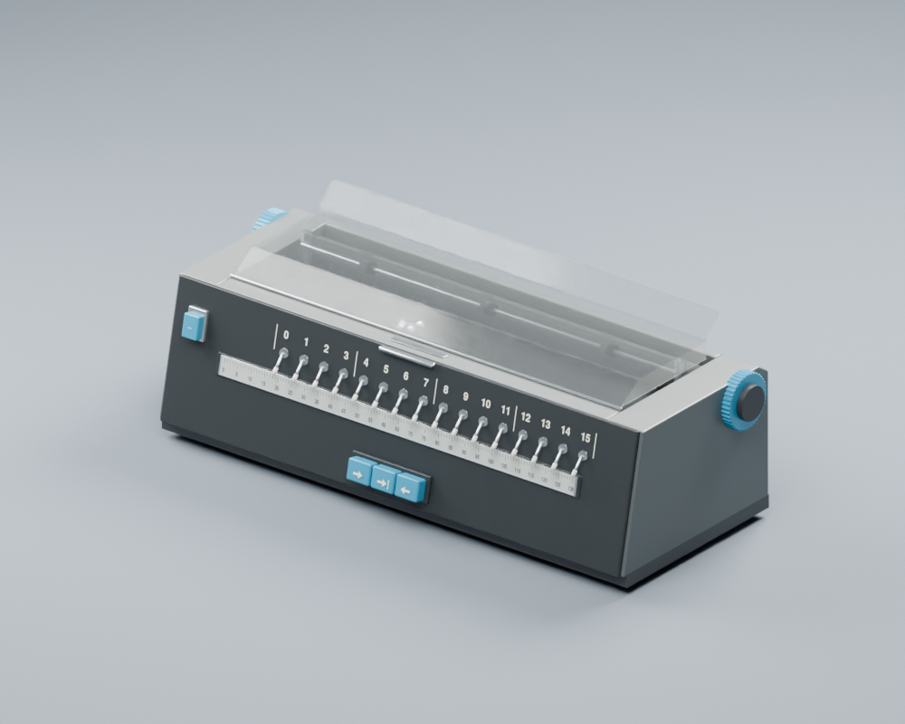
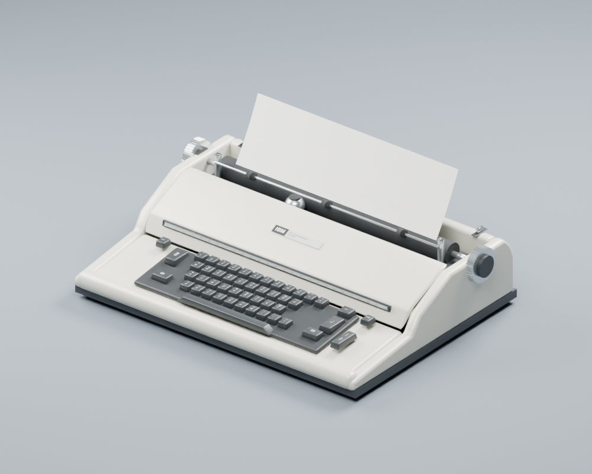
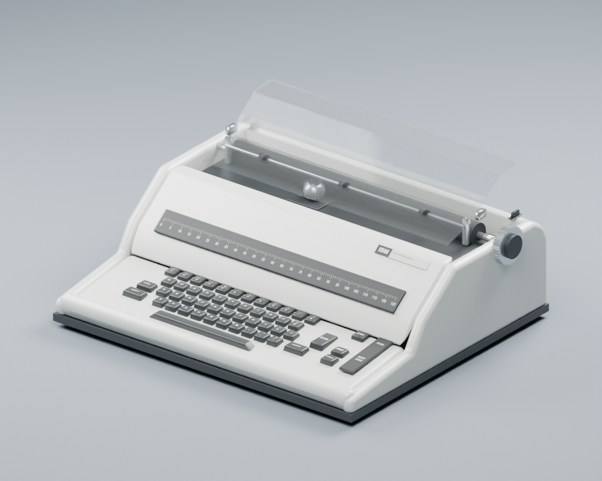

# IBM Console Studies — X_eTaL & Blender

**Three machines. One remarkable mechanism.** Compact procedural models of the
**IBM 1053 console (used on IBM 1130/1800 systems)**, **IBM 2741 APL terminal**, and **IBM 5471 System/3
printer-keyboard**, built around shared Selectric construction helpers.

The models are authored through X_eTaL's Blender extension and detailed Python
construction helpers. They export Blender, glTF, OBJ, and matched validation
renders. The preview includes model switching, original reference images, and
paired comparison viewers for the supplied dense reference GLBs.

## View the models

```sh
just view-serve     # serve existing output at http://127.0.0.1:5803/
just view           # open the configured interactive Chromium window
```

- [Three-model preview](http://127.0.0.1:5803/)
- [1053 / full console comparison](http://127.0.0.1:5803/compare.html)
- [2741 comparison](http://127.0.0.1:5803/compare.html?model=2741)
- [5471 comparison](http://127.0.0.1:5803/compare.html?model=5471)

The Linux launcher uses Lucy's verified dedicated Chromium profile and explicit
`--use-gl=angle --use-angle=swiftshader --enable-unsafe-swiftshader` flags. Use
`just view` to apply that configuration; opening a URL in another Chromium
instance does not apply launch flags. Render-only mode is available with
`?renders=1` on the main preview.

Drag either model in a comparison to orbit both. The 1053 viewer can show the
full reference console or its diagnostic printer region. The 5471 viewer can
show the original underside anomalies or the diagnostic body region excluding
those artifacts. Production geometry is rebuilt, not extracted from those cuts.

## Animate the shared mechanism

Open [program-controlled motion](http://127.0.0.1:5803/animate.html?model=2741)
for the 2741, 1053, or 5471. Apply tilt and rotation, advance, backspace, or return
the carrier using buttons, editable JSON commands, or `window.selectric`.
See [docs/animation.md](docs/animation.md) for the API, rig hierarchy, and limits.

```js
await selectric.select({tilt: 12, rotate: 65});
await selectric.advance(5);
await selectric.backspace(2);
await selectric.carriageReturn();
```

## Current models

| Model | Production meshes | Triangles | GLB | Principal evidence |
|---|---:|---:|---:|---|
| IBM 1053 / 1131 installation | 33 | 12,598 | 604 KiB | Two original console photographs and supplied full-console GLB |
| IBM 2741 APL terminal | 14 | 12,666 | 602 KiB | Museum photograph and supplied loaded-paper GLB |
| IBM 5471 System/3 console | 14 | 11,816 | 561 KiB | Supplied GLB plus IBM Components Reference Figures 8-1 and 8-2 |

### IBM 1053



The printer-only assembly retains the sixteen data switches, three blue printer
controls, position scale, clear formed cover, platen, knobs, and type element.
Its elevated 1130 indicator display and lower keyboard are excluded. Refinement
replaced the tall shoulder with a low shell and thin cover ledge, corrected the
panel frame, made printed legends readable, and reduced hundreds of primitive
nodes to compact static assemblies. The incidental orange sticker from the first
photo is excluded.

This model depicts the IBM 1130 arrangement, with data toggle switches on the
printer’s front cover. The IBM 1800 also used the 1053, but its toggle switches
were on the system’s large panel rather than the printer cover.

### IBM 2741



The desktop APL terminal has a low rounded enclosure, sculpted keycaps with a
shared print atlas, separate operator controls, exposed mechanism, and loaded
paper. Reference comparisons corrected the earlier tall enclosure and oversized
keyboard field. The type element is now positioned inside the printer well.
The complete desk-terminal configuration in IBM's OEM manual is separate from
this desktop model.

### IBM 5471



The System/3 console has its own rounded enclosure, keyboard, dark carrier scale,
right-hand request keys and status windows, side platen knob, and clear paper
deflector. Its clean lower case follows the user's correction and IBM's
illustration. The dense reference's hanging underside is not modeled as hardware.
The 44 graphic-key positions and separate controls follow Figure 8-2; the 2741's
APL keyboard is not reused as a 5471 keyboard.

Physical shell dimensions, some small details, and unseen rear fittings remain
provisional. Dense reconstructions are comparison aids rather than measurement
authorities. See [reference provenance](references/README.md) and
[remaining refinements](docs/refinement.md).

## Build

Requires Blender 5.x, Python 3, Git, Rust/Cargo for dependency setup, and optionally
`just`. The inspection viewer reuses `../lucy-3D/shared`; set `LUCY_SHARED_ROOT`
if that checkout is elsewhere.

```sh
just setup          # local ./X_eTaL-extensions and its pinned X_eTaL runtime
just render-gpu     # all three models with OptiX
just render         # all three models with CPU
just render-1053
just render-2741
just render-5471
just viewer         # rebuild preview from existing passing outputs
```

`EXTENSIONS_COMMIT` pins the extensions revision, whose `XETAL_COMMIT` pins the
core. Setup builds release `xetal-x` and the Blender native package. Override
`XETAL_EXTENSIONS_ROOT`, `XETAL_BIN`, or `BLENDER_BIN` as needed.

For another device or explicit timeout:

```sh
python3 scripts/build.py 2741 --device CUDA --timeout 900
```

`RENDER_SAMPLES` overrides 32 Cycles samples. `CONSOLE_FONT` can select a font for
remaining geometry labels. Printed textures are committed; optional regeneration
uses `uv run scripts/make_decals.py` and the documented GNU FreeFont files.

Each `work/ibmMODEL/out/` contains the `.blend`, `.glb`, `.obj`/`.mtl`, six PNG
views, generation/Blender logs, and `report.json`. Reports include physical-model
bounds, logical parts, meshes, triangles, draw calls, bytes, and GLB round-trip
checks. `work/preview/` contains the assembled inspection pages and downloads.
Generated files are ignored by Git; previous outputs and failed candidates are
retained under `work/`.

## Reference-driven refinement

Read [less-worse.md](less-worse.md), the requested reusable feedback loop, and the
local [less-wrong-3d skill](skills/less-wrong-3d/SKILL.md), copied from Lucy at the
user's request. [docs/plan.md](docs/plan.md) records checkpoints and
[docs/iterations.md](docs/iterations.md) records evidence and accepted/rejected
passes.

```sh
python3 scripts/build.py 1053 --device OPTIX --candidate-only
python3 scripts/compare.py --candidate work/ibm1053/candidate-TIMESTAMP/ibm1053.glb --label feature
python3 scripts/accept_candidate.py work/comparisons/RUN/comparison.json --reason 'Feature, evidence, measurement, remaining mismatch'
```

Use `--model 2741` or `--model 5471` with `compare.py` for the other models.
The comparison manifests in `models/` lock alignment, region, cameras, and asset
budget. Matched sheets contain reference, candidate, and silhouette differences.
Acceptance verifies asset/configuration hashes, artifacts, round-trip success,
and budget; visual review of all views remains required.

The 1053's five-view silhouette overlap improved from approximately
`0.77 / 0.67 / 0.68 / 0.67 / 0.54` to `0.88 / 0.84 / 0.86 / 0.87 / 0.72`.
The 2741 improved from `0.85 / 0.73 / 0.76 / 0.85 / 0.70` to
`0.94 / 0.88 / 0.90 / 0.92 / 0.84`. These are diagnostics of agreement with the
chosen reference masks, not historical-accuracy percentages; crop remnants,
transparency, and reconstruction errors affect them.

## Source organization

- `Ibm1053.xtl`, `Ibm2741.xtl`, `Ibm5471.xtl` — separate X_eTaL definitions.
- `make-ibmMODEL.xtl` — generate Blender scripts through `Blender.xtl`/`Bpy.xtl`.
- `scripts/console_scene.py` — common Selectric mechanism, distinct cases and
  controls, materials, compaction, rendering, and GLB validation.
- `models/*-keyboard.json`, `textures/` — keyboard layouts and small print atlases.
- `scripts/build.py`, `compare.py`, `accept_candidate.py` — build/review/promotion.
- `web/`, `scripts/make_preview.py` — three-model and paired-reference viewers.
- `scripts/check_preview.py`, `check_comparison.py` — real browser loading,
  controls, synchronized rotation, mobile layout, and console checks.

Author in meters, Blender Z-up, front −Y, right +X. Convert only at the viewer
boundary: `(x, y, z) → (x, z, −y)`. Shared viewer controls are W/S zoom, A/D or
left/right orbit, up/down elevation, I/K pan, Space rotation, and R reset. Reuse
Lucy's one input handler rather than adding listeners per model.

## Copyright and license

Copyright (c) 2026 Michael A. Wright. Project code is MIT licensed; see
[LICENSE](LICENSE) and [COPYRIGHT](COPYRIGHT). External photographs, manual scans,
and user-supplied reference models retain their own rights. Credits and exact
source paths are in [references/README.md](references/README.md).
